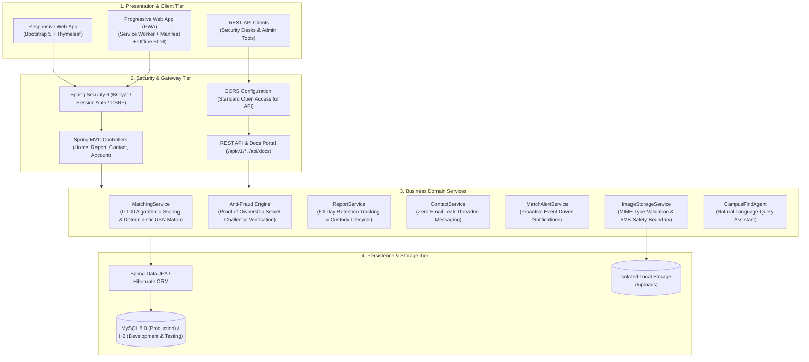

# CampusFind 🎒🔍

[](https://www.oracle.com/java/)
[](https://spring.io/projects/spring-boot)
[](https://github.com/saipraneeth1806/CampusFind/actions/workflows/ci.yml)
[](src/main/resources/static/manifest.webmanifest)
[](https://www.mysql.com/)
[](https://www.docker.com/)
[](https://playwright.dev/)
[](LICENSE)

> **An enterprise-grade, privacy-first Lost & Found web platform engineered for university campuses.**  
> Built with Spring Boot 3.5, Spring Security 6, Thymeleaf, MySQL, and Playwright. Designed with anti-fraud ownership verification challenges, zero-email leakage messaging, an explainable algorithmic matching engine, physical item custody tracking, and a 60-day university retention lifecycle.

---

## 📑 Table of Contents
- [Overview & Key Capabilities](#-overview--key-capabilities)
- [System Architecture](#-system-architecture)
- [Domain & Engineering Capabilities](#-domain--engineering-capabilities)
- [Technology Stack](#-technology-stack)
- [REST API Reference & Interactive Explorer](#-rest-api-reference--interactive-explorer)
- [Quickstart & Execution Guide](#-quickstart--execution-guide)
- [Docker & Containerized Deployment](#-docker--containerized-deployment)
- [Quality Assurance & Testing Suite](#-quality-assurance--testing-suite)

---

## 📌 Overview & Key Capabilities

CampusFind transforms informal, fragmented campus lost-and-found processes (social media threads, lost item WhatsApp groups, and bulletin boards) into a centralized, auditable, and privacy-preserving university service.

* **Explainable Multi-Factor Matching**: Implemented an automated scoring engine combining Levenshtein string similarity, category filters, temporal proximity, and campus building clustering. Achieves deterministic 100/100 matches when obfuscated student ID numbers match.
* **Anti-Fraud Proof-of-Ownership Challenge**: Solved false ownership claims on high-value electronics (laptops, phones, AirPods) by requiring finders to set a secret challenge question that claimants must answer in private messaging prior to custody handover.
* **Zero-Leakage Privacy Architecture**: Engineered in-app threaded messaging that completely shields students' personal phone numbers and institutional email addresses from public exposure.
* **Physical Custody & Retention Lifecycle**: Models real-world campus custody status (`WITH_FINDER`, `SECURITY_DESK`, `LIBRARY_DESK`, `DEPARTMENT_OFFICE`) alongside a 60-day countdown timer aligned with university property retention policies.
* **100% Green Automated Verification**: Verified by **38 automated tests**, comprising 34 Spring Boot unit/integration tests and 4 multi-user Playwright browser E2E workflows running on headless Chromium.

---

## 🏛️ System Architecture

<p align="center">
  
</p>

### Component Tier Hierarchy



---

## 🌟 Domain & Engineering Capabilities

### 1. 🛡️ Anti-Fraud Ownership Challenge
* **Problem**: Unrestricted public listings enable bad actors to claim high-value lost gadgets by memorizing publicly listed descriptions.
* **Engineering Solution**: Finders specify an optional **Secret Verification Challenge** (e.g., *"What sticker is on the laptop lid?"* or *"Describe the phone lock screen wallpaper"*). Claimants must answer this challenge in an initial private communication channel before custody handover is approved.

### 2. 🏛️ Physical Custody Tracking
* **Problem**: Students frequently report items found, but turn them over to security or departmental offices, leaving claimants unsure where the physical item is stored.
* **Engineering Solution**: The platform tracks verified custody status:
  * 🧑‍🎓 `WITH_FINDER` — Held by student finder (arranged via in-app message).
  * 🛡️ `SECURITY_DESK` — Deposited at 24/7 Main Security Desk (Gate 1).
  * 📚 `LIBRARY_DESK` — Stored at Central Library Circulation Helpdesk.
  * 🏢 `DEPARTMENT_OFFICE` — Logged at Department Administrative Office.

### 3. 🪪 Masked Student ID & Deterministic Matcher
* Student ID cards, library passes, and bus passes make up over 40% of all campus lost items.
* **Privacy Masking**: Publicly viewed ID cards display obfuscated identifiers (e.g., `1DS22CS104` renders as `1DS22***`), preventing identity theft.
* **Deterministic Matching**: When a lost report and found report share an identical unmasked student ID / USN, `MatchingService` assigns an automatic **100/100 perfect match score**.

### 4. ⏳ 60-Day University Retention Lifecycle
* Implements the standard statutory university lost property retention policy.
* Computes remaining retention days (`Report.getDaysRemainingInRetention()`) and renders an active status countdown bar.
* Flags items nearing expiration before legal university administrative disposal or charitable donation.

### 5. 🤝 Verified Safe Exchange Zones
* Promotes student physical safety by discouraging off-campus or isolated handovers.
* Recommends 4 designated, CCTV-monitored campus meeting points:
  * 📍 **Central Library Reception (Floor 1)**
  * 📍 **Campus Security Desk (Main Gate 1, 24/7)**
  * 📍 **Student Center Helpdesk (Ground Floor)**
  * 📍 **Cafeteria Information Counter (Daytime)**

### 6. 📍 Campus Hotspot & Building Explorer
* Provides one-click building filters for high-traffic zones:
  * 📚 Central Library &bull; 🔬 Science Block &bull; ☕ Cafeteria &bull; 🏛️ Student Center &bull; ⚙️ A Block &bull; 🏋️ Gymnasium
* Displays live item count badges for each facility with instant debounced search.

### 7. 🔒 Zero-Email Leakage Private Messaging
* Built-in peer-to-peer messaging system organized by item thread.
* **Privacy Protection**: Personal student phone numbers and email addresses are never exposed in HTML, URL parameters, or client-side payloads.

### 8. 📥 RFC 4180 Audit CSV Ledger
* Dedicated administrative endpoint (`GET /api/v1/reports/export.csv`) and UI download button.
* Exports compliant CSV logs for campus security desk audits, campus police records, or administrative reporting.

### 9. ⚡ Interactive Developer REST API Explorer (`/api/docs`)
* In-browser documentation and API testing suite.
* Features a **"Try It Out"** live console measuring HTTP response latency in milliseconds with syntax-highlighted responses.

### 10. 📱 Progressive Web App (PWA) & Offline Shell
* Responsive web application installable on mobile devices via `manifest.webmanifest`.
* Background Service Worker (`sw.js`) caches application shell assets (stylesheets, JavaScript, SVGs) for instant offline loading.

### 11. 🖨️ Printable Notice Flyers & Scan-to-Claim QR Codes
* Dynamically generates item-specific QR codes on detail pages.
* Dedicated `@media print` CSS formats listings into printable flyers suitable for campus physical bulletin boards.

---

## 💻 Technology Stack

| Layer | Technologies |
|---|---|
| **Backend Framework** | **Spring Boot 3.5.16**, Java 17 |
| **Security & Auth** | **Spring Security 6**, BCrypt Password Encoder, Session Management |
| **Persistence & ORM** | **Spring Data JPA**, Hibernate 6, MySQL Connector/J |
| **Databases** | **MySQL 8.0** (Production) / **H2 Database** (In-Memory Dev & Test) |
| **Frontend & UI** | **Thymeleaf**, Bootstrap 5.3, Vanilla ES6+ JavaScript, CSS3 Variables |
| **Testing** | **JUnit 5**, Mockito, Spring Boot Test, **Playwright (Chromium E2E)** |
| **DevOps & Containers** | **Docker**, Docker Compose, GitHub Actions CI, Maven |

---

## 📡 REST API Reference & Interactive Explorer

CampusFind includes a clean REST API for institutional integrations, administrative tools, and automated security desk lookups. Visit `/api/docs` in your browser for the live interactive console.

| Method | Endpoint | Description |
|---|---|---|
| `GET` | `/api/health` | System health check and uptime diagnostic |
| `GET` | `/api/v1/stats` | Aggregate campus metrics (total reports, open lost, open found, recovery rate) |
| `GET` | `/api/v1/reports` | Filtered, paginated search (`q`, `type`, `category`, `status`, `page`, `size`) |
| `GET` | `/api/v1/reports/{id}` | Single report details, physical custody, masked student ID, and photo metadata |
| `GET` | `/api/v1/reports/export.csv` | Download RFC 4180 compliant CSV campus audit ledger |
| `GET` | `/api/v1/categories` | Metadata listing of item categories and user-friendly labels |
| `GET` | `/api/notifications/unread-count` | Real-time counter of unread user messages and match alerts |
| `GET` | `/api/docs` | Interactive in-browser developer testing portal |

---

## 🚀 Quickstart & Execution Guide

### Prerequisites
* **Java 17+** (JDK)
* **Maven 3.8+** (or use included wrapper)
* Optional: **MySQL 8.0** (for production profile)

---

### Option 1: In-Memory Mode (Zero Database Setup Required)
Runs on an embedded H2 database with automatic sample campus data seeding:

```powershell
# On Windows:
.\run-dev.bat

# On macOS / Linux:
mvn spring-boot:run -Dspring-boot.run.profiles=dev
```
Open **`http://localhost:8080`** in your browser.

#### Demo Credentials:
Click any demo chip on the `/login` page to auto-fill:
* **Student A**: `demo@campus.edu` / `CampusFind-123`
* **Student B**: `helper@campus.edu` / `CampusFind-123`

---

### Option 2: Production Mode (MySQL 8.0)
1. Initialize the database using `create-database.sql`:
   ```sql
   CREATE DATABASE IF NOT EXISTS campusfind CHARACTER SET utf8mb4 COLLATE utf8mb4_unicode_ci;
   ```
2. Launch with environment variables:
   ```powershell
   $env:DB_URL="jdbc:mysql://localhost:3306/campusfind"
   $env:DB_USERNAME="root"
   $env:DB_PASSWORD="yourpassword"
   .\run-mysql.bat
   ```

---

## 🐳 Docker & Containerized Deployment

### Standalone Docker Container
```bash
# Build the production Docker image
docker build -t campusfind .

# Run container in dev/demo mode
docker run -d -p 8080:8080 -e SPRING_PROFILES_ACTIVE=dev --name campusfind-app campusfind
```

### Multi-Container Setup with Docker Compose (App + MySQL 8.0)
```bash
# Start both the Spring Boot app and MySQL 8.0 database in the background
docker-compose up -d

# View live application logs
docker-compose logs -f app

# Stop all containers
docker-compose down
```

### Production Cloud Deployment
The repository includes production configuration files ready for deployment on containerized cloud platforms (Render, Railway, Fly.io, or AWS ECS):
* `Dockerfile` — Multi-stage build packaging a secure, non-root OpenJDK 17 runtime.
* `render.yaml` — Declarative Infrastructure-as-Code for auto-provisioning web service, persistent disk mounts (`/uploads`), and health checks.

---

## 🧪 Quality Assurance & Testing Suite

CampusFind enforces strict automated test verification across both business logic and user-facing browser flows:

| Test Suite | Focus Area | Tests | Status |
|---|---|:---:|:---:|
| **Unit & Integration Suite** | Algorithmic matching, anti-fraud rules, retention math, CSV export, REST APIs | 34 | ✅ **Passed** |
| **Playwright Browser E2E Suite** | Multi-user registration, item posting, private chat, notification alerts in Chromium | 4 | ✅ **Passed** |
| **Total Test Suite** | Full regression and validation pipeline | **38** | ✅ **100% Green** |

### Run Tests Locally

```bash
# Run unit and integration tests:
mvn test -Dtest="!*Playwright*"

# Run Playwright Chromium end-to-end browser tests:
mvn test -Dtest="*Playwright*"

# Run entire test suite:
mvn test
```

---

## 📜 License
This project is open-source under the [MIT License](LICENSE).
