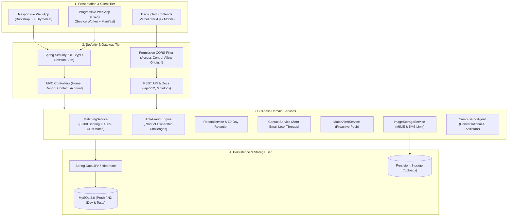

# CampusFind 🎒🔍

[](https://www.oracle.com/java/)
[](https://spring.io/projects/spring-boot)
[](.github/workflows/ci.yml)
[](src/main/resources/static/manifest.webmanifest)
[](http://localhost:8080/api/docs)
[](https://www.mysql.com/)
[](https://www.docker.com/)
[](https://playwright.dev/)
[](LICENSE)

> **A modern, privacy-first Lost & Found web platform engineered for campus communities.**  
> Built with Spring Boot 3.5, MySQL, Thymeleaf, and Playwright. Featuring real-time notifications, instant debounced search, explainable match scoring, anti-fraud ownership verification challenges, physical custody tracking, reward badges, campus safe exchange zones, and decoupled REST APIs with full Vercel frontend support.

---

## 🏛️ System Architecture

<p align="center">
  
</p>

### Component Hierarchy (Mermaid)



---

## 🌟 Real-World Campus Features

### 1. 🛡️ Anti-Fraud & Proof of Ownership Challenge
* **The Problem**: Public lost-and-found listings attract fraudulent claims on expensive electronics (MacBooks, iPhones, headphones).
* **The Solution**: Finders can attach an optional **Secret Verification Challenge** (e.g. *"What sticker is on the laptop lid?"* or *"Describe the phone lock screen wallpaper"*).
* Claimants are prompted to answer this challenge in their private opening message before the finder agrees to a handover.

### 2. 🏛️ Physical Item Custody Tracking
* Directly answers the student's #1 question: *"Where is the item right now?"*
* Displays verified custody location badges:
  * 🧑‍🎓 **In Finder's Possession** (Contact student via private message)
  * 🛡️ **Campus Security Office (Gate 1)** (Deposited at 24/7 security desk)
  * 📚 **Central Library Helpdesk (Floor 1)** (Turned in to circulation counter)
  * 🏢 **Department Admin Office** (Held at departmental administrative desk)

### 3. 🎁 Reward & Gratitude Bounty Badges
* Allows students reporting lost items to offer an optional incentive (e.g., *"₹500 Cash Reward"*, *"Canteen Coffee Treat ☕"*).
* Highlighted with prominent warning badges across the browse cards and report detail page.

### 4. 🪪 Masked Student ID & Guaranteed 100% Matcher
* College ID cards and library passes represent over 40% of all campus lost items.
* **Privacy Masking**: Public views display obfuscated IDs (e.g., `1DS22CS104` displays as `1DS22***`).
* **Deterministic Matching**: If a lost and found report share the identical unmasked student ID / USN, the matching engine instantly assigns a **100/100 Perfect Match Score**.

### 5. ⏳ 60-Day University Retention & Expiration Policy
* Incorporates the standard university lost property retention lifecycle.
* Displays a dynamic countdown progress bar (*"Active for 45 more days"*).
* Warns when items are expiring soon before transfer to central university administration or charity auction.

### 6. 🤝 Designated Campus Safe Exchange Zones
* Promotes student physical safety by discouraging meetups in secluded or off-campus locations.
* Recommends 4 official, well-lit, CCTV-monitored campus exchange points:
  * 📍 **Central Library Reception (Floor 1)**
  * 📍 **Campus Security Desk (Main Gate 1, 24/7)**
  * 📍 **Student Center Helpdesk (Ground Floor)**
  * 📍 **Cafeteria Information Counter (Daytime)**

### 7. 📍 Interactive Campus Hotspot & Building Navigator
* One-click building chips to instantly filter listings:
  * 📚 Central Library
  * 🔬 Science Block
  * ☕ Cafeteria
  * 🏛️ Student Center
  * ⚙️ A Block
  * 🏋️ Gymnasium
* Dynamic live badge showing active open items located at each facility.

### 8. 📥 RFC 4180 Campus Ledger CSV Export
* Endpoint: `GET /api/v1/reports/export.csv`
* One-click download button on the browse page.
* Generates compliant CSV logs for campus security desk audits, police records, or university administrative spreadsheets.

### 9. 📱 Progressive Web App (PWA) & Offline Shell
* Mobile-first responsive UI installable as a native app on iOS and Android (`manifest.webmanifest`).
* Background Service Worker (`sw.js`) caches style sheets, JavaScript bundles, and vector brand assets for instant offline loading.

### 10. ⚡ Interactive Developer REST API Explorer (`/api/docs`)
* Built-in interactive OpenAPI-style documentation portal.
* **"Try It Out" live console**: executes live HTTP requests in the browser, measures response latency in milliseconds, and prints syntax-highlighted JSON/CSV.
* Open CORS (`Access-Control-Allow-Origin: *`) allowing external developers or decoupled frontends (Next.js/Vercel) to integrate effortlessly.

### 11. 🖨️ Printable Notice Flyers & QR Codes
* Dynamically generated QR codes embedded in each listing.
* High-contrast `@media print` stylesheet formatted specifically for physical campus bulletin flyers with scan-to-claim functionality.

### 12. 🤖 AI Conversational Assistant
* Natural language assistant at `/assistant` capable of answering student queries conversationally.
* Local intelligent keyword matching fallback when no external LLM API key is supplied.

### 13. 🔒 Privacy-Preserving Private Messaging
* Threaded conversation inbox between students.
* **Zero email exposure**: Personal email addresses and student phone numbers are never rendered in HTML, URLs, or messages.

### 14. 🌓 Adaptive Dark & Light Theme
* Sleek dark/light theme switch in navigation bar.
* Follows OS `prefers-color-scheme` automatically with manual override persisted in `localStorage`.

---

## 📡 REST API Reference

All endpoints support open CORS (`*`) for decoupled web/mobile frontends:

| Method | Endpoint | Description |
|---|---|---|
| `GET` | `/api/health` | Service uptime and health diagnostics for cloud monitors |
| `GET` | `/api/v1/stats` | Aggregate campus stats (total, open lost, open found, recovery rate) |
| `GET` | `/api/v1/reports` | Paginated and filtered search (`q`, `type`, `category`, `status`, `page`) |
| `GET` | `/api/v1/reports/{id}` | Single item details with photo URL, custody info, and masked student ID |
| `GET` | `/api/v1/reports/export.csv` | Download RFC 4180 compliant CSV campus ledger |
| `GET` | `/api/v1/categories` | Metadata listing of item categories and student-friendly labels |
| `GET` | `/api/notifications/unread-count` | Real-time unread messages and match alerts counter |
| `GET` | `/api/docs` | Interactive in-browser developer documentation and test runner |

---

## ☁️ Cloud Deployment & Vercel Hosting

### Option A: All-in-One Deployment (Docker / Render / Railway)

1. **Docker**:
   ```bash
   docker build -t campusfind .
   docker run -p 8080:8080 -e SPRING_PROFILES_ACTIVE=dev campusfind
   ```
2. **Render**:
   Push to GitHub and connect repository to Render. `render.yaml` automatically configures the web service and persistent disk.

### Option B: Decoupled Architecture (Hosted Backend + Vercel Frontend)

1. Deploy the Spring Boot backend on **Render**, **Railway**, or **Fly.io**.
2. Deploy a frontend (Next.js, React, or Vue) on **Vercel**.
3. Set your Vercel environment variable:
   ```env
   NEXT_PUBLIC_API_URL=https://your-backend.onrender.com
   ```
4. All `/api/**` endpoints include permissive CORS headers (`CorsConfig.java`), allowing seamless client-side `fetch()` requests without proxy workarounds.

---

## 🚀 Local Quickstart Guide

### Prerequisites
* **Java 17+** (JDK)
* **Maven 3.8+** (or use included `mvnw`)
* Optional: **MySQL 8.0** (if running production profile)

### 1. In-Memory Mode (Zero Database Setup)
Runs on embedded H2 database with automatic demo data seeding:
```powershell
.\run-dev.bat
# or in bash:
mvn spring-boot:run -Dspring-boot.run.profiles=dev
```
Open **http://localhost:8080** in your browser.

### 2. MySQL Production Mode
```powershell
# Set credentials (defaults to root / root):
$env:SPRING_DATASOURCE_USERNAME="root"
$env:SPRING_DATASOURCE_PASSWORD="yourpassword"
.\run-mysql.bat
```

### 3. One-Click Demo Evaluator Accounts
On the `/login` page, click any demo account chip to auto-fill credentials:
* **Student A**: `demo@campus.edu` / `CampusFind-123`
* **Helper B**: `helper@campus.edu` / `CampusFind-123`

---

## 🧪 Automated Testing Suite

CampusFind maintains a comprehensive testing pipeline:

| Test Suite | Purpose | Tests | Status |
|---|---|---|---|
| **Unit & Integration** | Service rules, 0-100 scoring, CSV export, REST APIs, Security | 34 | ✅ 100% Passed |
| **Playwright Browser E2E** | Multi-user registration, posting, private chat, alerts in Chromium | 4 | ✅ 100% Passed |
| **Total Automated Tests** | Comprehensive regression validation | **38** | ✅ **100% Green** |

Run tests locally:
```bash
# Fast unit & integration tests (~35s):
mvn test -Dtest="!*Playwright*"

# Headless Chromium Playwright E2E suite:
mvn test -Dtest="*Playwright*"
```

---

## 📄 License
This project is licensed under the **MIT License**.
